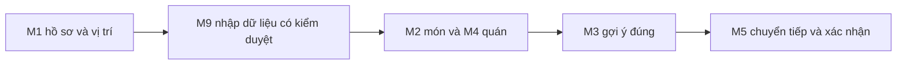

# Kế hoạch hoàn tất 6 module lõi — Taste of Vietnam

Ứng dụng đã lưu dữ liệu thật, nhưng các luồng sử dụng chưa đủ để ra mắt; cần hoàn tất trên giao diện có sẵn.

## Tóm tắt cho anh

| Module | Ước lượng hoàn tất | Đã có | Khoảng trống lớn nhất |
| --- | ---: | --- | --- |
| M1 Tài khoản, khẩu vị | 45% | Khách, mã OTP, hồ sơ riêng, lưu DB, xóa | Đăng nhập thật, GPS, đồng ý dữ liệu, nối onboarding |
| M2 Món và công thức | 45% | Tìm không dấu, chi tiết, chia khẩu phần, lưu | Nội dung có quyền sử dụng, các màn còn mẫu, hợp đồng API lệch |
| M3 Gợi ý và Măm | 35% | Bộ lọc dị ứng, 3 gợi ý, phản hồi, lịch sử | Chế độ ăn/bữa ăn chưa áp dụng đủ; AI và trò chơi không cùng bộ lọc |
| M4 Quán và bản đồ | 30% | Tìm gần bằng PostGIS, báo sai, tạm ẩn | Quán thật, GPS, giờ mở cửa thật, bản đồ và chi tiết |
| M5 Đặt ngoài, chỉ đường | 35% | Lưu lượt chuyển tiếp, xác nhận đã ăn | Nút UI chưa đi qua API; link mẫu, gọi điện sai định dạng |
| M9 Quản trị | 30% | Chặn quyền, món CRUD, duyệt cơ bản, audit DB | Quản trị công thức/quán, phân quyền thật, giữ lịch sử xử lý |

**Đây là ước lượng kỹ thuật theo các luồng bắt buộc dưới đây, không phải tỷ lệ test đạt, số màn đã vẽ hay cam kết tiến độ.** Mỗi module chấm 5 mặt ngang trọng số: UI thao tác thật, quy tắc nghiệp vụ, dữ liệu bền vững, dữ liệu vận hành thật, an toàn/kiểm thử; làm tròn 5%. Chỉ 100% khi tất cả tiêu chí nghiệm thu bắt buộc đạt. Không cộng công việc PR #3 chưa gộp.

> **Anh cần quyết khi bắt đầu nhập dữ liệu và đăng nhập:** thành phố mở đầu; nguồn/quyền món–quán–ảnh; SMS OTP hay Google/Zalo; người được quyền quản trị. Đề xuất: một thành phố, kho nội dung nhỏ được xác minh, một cách đăng nhập trước. Chưa bật thanh toán hoặc quảng cáo.

- [x] Đọc thiết kế, API, lưu trữ và test của 6 module; giữ nguyên bố cục Live App và các màn trong repo.
- [x] Chạy lại 69/69 test bộ nhớ và 13/13 test PostgreSQL trên máy riêng.
- [ ] Chưa chứng minh toàn bộ luồng bằng trình duyệt với PostgreSQL và nhà cung cấp thật.

## 0. Phạm vi, bằng chứng và cách đọc

- Mốc đọc: `main` **9adf9e0**, ngày 25–26/11/2026. Mọi nhận xét “hiện có” dưới đây là ở mốc này, không phải toàn bộ sản phẩm đã chạy thật.
- Chỉ M1–M5 và M9, web/PWA trước. M6–M8, M10–M20 và Flutter đóng băng; M9-S07 phụ thuộc quảng cáo M7 chỉ giữ ẩn/chỉ đọc, không mở kinh doanh. Các cơ chế bảo vệ tài trợ hiện có vẫn phải đúng nếu còn dữ liệu cũ.
- Nguồn nội bộ đã đối chiếu: `docs/PRODUCT_SPEC_v0.1.md`, `docs/UI_UX_DESIGN_SPEC.md`, `docs/TECHNICAL_HANDOFF_SPEC.md`, `docs/DELIVERY_TRACKER.md`; `ui-design/src/app_shell.html`, `screens_m1_m2.js`, `screens_m3_m4_m5_m8.js`, `screens_m9_m10_expansion.js`; `server.js`, `src/api/router.js`, `accessPolicy.js`, `src/services/*`, `src/db/{postgresRepository,memoryRepository,repository}.js`, migrations và tests.
- **Tracker “20/20 hoàn thành”, “99 màn chạy thật”, “100% NLU” không phải bằng chứng.** Test “E2E Full Loop” hiện chủ yếu gọi router, không bấm UI và không đi sang Grab/ShopeeFood.
- Kho mẫu có **12 món, 8 quán** khi seed DB trống. Con số hiển thị trên prod có thể khác vì dữ liệu được giữ lại; không suy ra số bản ghi prod từ seed. Thành phố, thời tiết và nhiều link vẫn mẫu.
- Lưu trữ đã thật: khi có `DATABASE_URL`, server dùng repository PostgreSQL, không âm thầm rơi về bộ nhớ; users, OTP, hồ sơ, collections, history, redirects, món, quán, reports và audit có bảng thật. Không có nghĩa là dữ liệu mẫu đã được xác minh.
- Thiết kế ưu tiên **mã render trong `screens_*.js` và Live App**, vì bảng mã trong PRODUCT_SPEC tự mâu thuẫn: M1-S08 thực tế là vị trí; M2-S05 dinh dưỡng, S06 chia khẩu phần, S07 bước nấu, S08 đã lưu; M4-S01 danh sách/S02 bản đồ; M5-S02 chọn đối tác/S03 chỉ đường/S04 gọi điện; M9-S03 công thức/S04 duyệt quán/S05 OCR/S06 báo sai. Dùng các mã này trong kế hoạch, không đổi thiết kế để khớp bảng sai.
- API dưới đây có tiền tố `/api/v1`. Không tạo thêm endpoint chỉ vì nhãn `api:` trên mockup ghi như vậy: ưu tiên dùng endpoint đang có; phần mới phải ghi rõ là **đề xuất**.
- Cỡ: **S** ≤1 ngày, **M** 2–4 ngày, **L** 1–2 tuần, cho một người triển khai; L cần chia thành PR nhỏ. Đây không phải lịch giao. Mỗi dòng gồm màn, API/logic, dữ liệu và cách kiểm.
- **P2 / PR #3:** đã đọc PR mở ở `079014cb1724caf1bc26abfbde2af82f91daef65`. Tại lần đọc này vẫn là product shell mới (đã bị anh từ chối); luồng P2 đang sửa lại trên `app_shell.html` từ main mới. Những dòng đánh dấu **P2** là phần giao diện dự kiến do PR này phụ trách, **không tính đã xong**. P2 không thay thế việc sửa logic, dữ liệu hay API dưới đây. Cần đọc lại head PR trước nhận việc và trước gộp.

## 1. M1 — Tài khoản, vị trí và khẩu vị (45%)

### Ý định và màn giữ lại

`screens_m1_m2.js`: S01 chào/đăng nhập/khách; S02 OTP; S03 vùng; S04 cay; S05 dị ứng; S06 chế độ ăn; S07 ngân sách; S08 GPS/chọn khu vực; S09 hồ sơ; S10 cài đặt/xuất/xóa. Live App có `lpanel-profile`, `loadLiveProfile`, `saveLiveProfile`, `exportPdpdData`, `deleteAccountPdpd`. Mục tiêu onboarding dưới 45 giây là yêu cầu thiết kế, chưa được đo.

### Hiện chạy được và còn giả

- API `/auth/guest`, `/auth/otp/request`, `/auth/otp/verify`, `/auth/me`, `/me/profile` GET/PUT/PATCH, `/me/export`, DELETE `/me` có thật. JWT có hạn, OTP ngẫu nhiên/hash/giới hạn thử; DB giữ tài khoản, OTP, hồ sơ qua khởi động lại. Guest cũng có tài khoản riêng.
- Live App tự xin guest token, sửa và lưu hồ sơ tới DB được theo đường mã. Các nút social và onboarding trong bộ màn thiết kế chủ yếu `goScreen`, không thực hiện đăng nhập hay lưu từng bước.
- Production thiếu eSMS thì OTP trả 503, không phát mã giả. Chưa thử SMS thật. Không có Google/Apple/Zalo dù mockup vẽ nút.
- Không thấy `navigator.geolocation` trong Live App. `/me/location`, `/me/consent` ghi ở mockup chưa có route. Hồ sơ mới sao chép Biên Hòa, dị ứng mẫu và `pdpd_consent: true`: không phải người dùng đã tự chọn/đồng ý.
- API nhận gần như toàn bộ trường JSON hồ sơ (ngoại trừ id/phone/role), thiếu schema kiểu dữ liệu, miền giá trị; có thể làm recommender lỗi. UI xuất JSON chỉ xuất biến hồ sơ, không gọi `/me/export`; API export chỉ lấy tối đa 50 lịch sử và analytics tổng dùng chung trong RAM. Không nên tuyên bố “toàn bộ dữ liệu/tuân thủ pháp luật” từ kết quả này.
- Guest → đăng nhập tạo/dùng tài khoản điện thoại khác, chưa chuyển collections/history/khẩu vị của khách. Cần xử lý hết hạn token, đăng xuất và lưu cache riêng tư; xóa DB đã có nhưng giao diện chưa dọn token chắc chắn.

### Nghiên cứu dùng để hoàn thiện

eSMS yêu cầu đăng ký Brandname trước; API GENCODE còn yêu cầu template. Có key chưa đảm bảo gửi được SMS [R1]. Đề xuất giữ cách OTP hiện có cho bản đầu **nếu** có tài khoản/Brandname đã duyệt; không mở cả 4 cách đăng nhập cùng lúc. Dị ứng là dữ liệu cần thận trọng; Cookpad cũng phân biệt thông tin dị ứng trong chính sách riêng tư [R3]. Chính sách pháp lý cần rà soát văn bản hiện hành, không chỉ lặp nhãn NĐ 13/2023 cũ.

### Việc theo thứ tự

| ID / cỡ | Màn có sẵn | Logic/API + dữ liệu phải làm | Nghiệm thu / phụ thuộc |
| --- | --- | --- | --- |
| M1-1 M **P2** | S01–S07, S09 | Nối nút/field thật vào auth/profile; lưu draft onboarding; dùng `regions`, `hard_allergies`, `budget_min/max` đúng trường; bỏ nút social chưa hỗ trợ, bỏ nhãn bảo mật 2 lớp sai | 2 người lưu khác nhau, tải lại/khởi động lại vẫn đúng; không toast thành công khi 4xx/5xx |
| M1-2 M | S03–S09 | Schema profile, enum vùng/chế độ ăn/allergen, số hữu hạn/cay 0–3/ngân sách hợp lệ/lat ±90/lng ±180; mặc định trung tính, chưa hỏi không được gán dị ứng hoặc đồng ý | Payload sai trả 400, không ghi DB; fixture null/mảng sai không làm API 500 |
| M1-3 M | S01–S02 | Chốt một provider; nếu SMS: kiểm template, timeout/retry có chủ ý, per-IP/per-phone/per-device rate limit và hạn mức chi phí; không log OTP/token ở prod | Đúng/sai/hết hạn/gửi lại/nhà mạng lỗi; không trả dev_code ở prod. **Cần chọn cách đăng nhập + key/Brandname; không gửi tin trả phí khi chưa duyệt** |
| M1-4 M | S08 | GPS có xin quyền, timeout/denied → picker khu vực; lưu lat/lng/khu vực/độ chính xác bằng `/me/profile`; không cần route location riêng | Cho phép/từ chối/máy không GPS đều đi tiếp; vị trí thay đổi làm M4 khác. **Cần thành phố + danh mục khu vực hợp lệ** |
| M1-5 M | S01–S02, S08–S10 | Gộp dữ liệu guest vào tài khoản khi login bằng transaction và quy tắc chống trùng; logout/expiry dọn token, không tự replay lệnh ghi | Khách lưu món → login vẫn còn; không trộn người khác, 401 không phát lệnh hai lần |
| M1-6 M | S10 | Đồng ý theo mục đích/version/thời điểm, tối thiểu hóa vị trí; UI gọi export thật, phân trang đủ lịch sử, bỏ analytics chung; xóa/dọn cache/token, mô tả rõ dữ liệu tài chính giữ nhưng bỏ liên kết | Export chỉ dữ liệu mình và đủ >50 lịch sử; xóa xong token cũ 401; mở offline không lộ hồ sơ trước. **Cần nội dung chính sách/chủ thể chịu trách nhiệm dữ liệu** |

