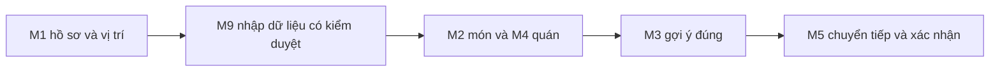

# Kế hoạch hoàn tất 6 module lõi — Taste of Vietnam

Ứng dụng đã lưu dữ liệu thật, nhưng các luồng sử dụng chưa đủ để ra mắt; cần hoàn tất trên giao diện có sẵn.

## Tóm tắt cho anh

| Module | Ước lượng hoàn tất | Đã có | Khoảng trống lớn nhất |
| --- | ---: | --- | --- |
| M1 Tài khoản, khẩu vị | 45% | Khách, mã OTP, hồ sơ riêng, lưu DB, xóa | Đăng nhập thật, GPS, đồng ý dữ liệu, nối onboarding |
| M2 Món và công thức | 45% | Tìm không dấu, chi tiết, chia khẩu phần, lưu | Nội dung có quyền sử dụng, các màn còn mẫu, hợp đồng API lệch |
| M3 Gợi ý và Măm | 35% | Bộ lọc dị ứng, 3 gợi ý, phản hồi, lịch sử | Chế độ ăn/bữa ăn chưa áp dụng đủ; AI và trò chơi không cùng bộ lọc |
| M4 Quán và bản đồ | 30% | Tìm gần bằng PostGIS, báo sai, tạm ẩn | Quán thật, GPS, giờ mở cửa thật, bản đồ và chi tiết |
| M5 Đặt ngoài, chỉ đường | 35% | Lưu lượt chuyển tiếp, xác nhận đã ăn | Nút UI chưa đi qua API; link mẫu, gọi điện sai định dạng |
| M9 Quản trị | 30% | Chặn quyền, món CRUD, duyệt cơ bản, audit DB | Quản trị công thức/quán, phân quyền thật, giữ lịch sử xử lý |

**Đây là ước lượng kỹ thuật theo các luồng bắt buộc dưới đây, không phải tỷ lệ test đạt, số màn đã vẽ hay cam kết tiến độ.** Mỗi module chấm 5 mặt ngang trọng số: UI thao tác thật, quy tắc nghiệp vụ, dữ liệu bền vững, dữ liệu vận hành thật, an toàn/kiểm thử; làm tròn 5%. Chỉ 100% khi tất cả tiêu chí nghiệm thu bắt buộc đạt. Không cộng công việc PR #3 chưa gộp.

> **Anh cần quyết khi bắt đầu nhập dữ liệu và đăng nhập:** thành phố mở đầu; nguồn/quyền món–quán–ảnh; SMS OTP hay Google/Zalo; người được quyền quản trị. Đề xuất: một thành phố, kho nội dung nhỏ được xác minh, một cách đăng nhập trước. Chưa bật thanh toán hoặc quảng cáo.

- [x] Đọc thiết kế, API, lưu trữ và test của 6 module; giữ nguyên bố cục Live App và các màn trong repo.
- [x] Chạy lại 69/69 test bộ nhớ và 13/13 test PostgreSQL trên máy riêng.
- [ ] Chưa chứng minh toàn bộ luồng bằng trình duyệt với PostgreSQL và nhà cung cấp thật.

## 0. Phạm vi, bằng chứng và cách đọc

- Mốc đọc: `main` **9adf9e0**, ngày 25–26/11/2026. Mọi nhận xét “hiện có” dưới đây là ở mốc này, không phải toàn bộ sản phẩm đã chạy thật.
- Chỉ M1–M5 và M9, web/PWA trước. M6–M8, M10–M20 và Flutter đóng băng; M9-S07 phụ thuộc quảng cáo M7 chỉ giữ ẩn/chỉ đọc, không mở kinh doanh. Các cơ chế bảo vệ tài trợ hiện có vẫn phải đúng nếu còn dữ liệu cũ.
- Nguồn nội bộ đã đối chiếu: `docs/PRODUCT_SPEC_v0.1.md`, `docs/UI_UX_DESIGN_SPEC.md`, `docs/TECHNICAL_HANDOFF_SPEC.md`, `docs/DELIVERY_TRACKER.md`; `ui-design/src/app_shell.html`, `screens_m1_m2.js`, `screens_m3_m4_m5_m8.js`, `screens_m9_m10_expansion.js`; `server.js`, `src/api/router.js`, `accessPolicy.js`, `src/services/*`, `src/db/{postgresRepository,memoryRepository,repository}.js`, migrations và tests.
- **Tracker “20/20 hoàn thành”, “99 màn chạy thật”, “100% NLU” không phải bằng chứng.** Test “E2E Full Loop” hiện chủ yếu gọi router, không bấm UI và không đi sang Grab/ShopeeFood.
- Kho mẫu có **12 món, 8 quán** khi seed DB trống. Con số hiển thị trên prod có thể khác vì dữ liệu được giữ lại; không suy ra số bản ghi prod từ seed. Thành phố, thời tiết và nhiều link vẫn mẫu.
- Lưu trữ đã thật: khi có `DATABASE_URL`, server dùng repository PostgreSQL, không âm thầm rơi về bộ nhớ; users, OTP, hồ sơ, collections, history, redirects, món, quán, reports và audit có bảng thật. Không có nghĩa là dữ liệu mẫu đã được xác minh.
- Thiết kế ưu tiên **mã render trong `screens_*.js` và Live App**, vì bảng mã trong PRODUCT_SPEC tự mâu thuẫn: M1-S08 thực tế là vị trí; M2-S05 dinh dưỡng, S06 chia khẩu phần, S07 bước nấu, S08 đã lưu; M4-S01 danh sách/S02 bản đồ; M5-S02 chọn đối tác/S03 chỉ đường/S04 gọi điện; M9-S03 công thức/S04 duyệt quán/S05 OCR/S06 báo sai. Dùng các mã này trong kế hoạch, không đổi thiết kế để khớp bảng sai.
- API dưới đây có tiền tố `/api/v1`. Không tạo thêm endpoint chỉ vì nhãn `api:` trên mockup ghi như vậy: ưu tiên dùng endpoint đang có; phần mới phải ghi rõ là **đề xuất**.
- Cỡ: **S** ≤1 ngày, **M** 2–4 ngày, **L** 1–2 tuần, cho một người triển khai; L cần chia thành PR nhỏ. Đây không phải lịch giao. Mỗi dòng gồm màn, API/logic, dữ liệu và cách kiểm.
- **P2 / PR #3:** đã đọc PR mở ở `079014cb1724caf1bc26abfbde2af82f91daef65`. Tại lần đọc này vẫn là product shell mới (đã bị anh từ chối); luồng P2 đang sửa lại trên `app_shell.html` từ main mới. Những dòng đánh dấu **P2** là phần giao diện dự kiến do PR này phụ trách, **không tính đã xong**. P2 không thay thế việc sửa logic, dữ liệu hay API dưới đây. Cần đọc lại head PR trước nhận việc và trước gộp.

## 1. M1 — Tài khoản, vị trí và khẩu vị (45%)

### Ý định và màn giữ lại

`screens_m1_m2.js`: S01 chào/đăng nhập/khách; S02 OTP; S03 vùng; S04 cay; S05 dị ứng; S06 chế độ ăn; S07 ngân sách; S08 GPS/chọn khu vực; S09 hồ sơ; S10 cài đặt/xuất/xóa. Live App có `lpanel-profile`, `loadLiveProfile`, `saveLiveProfile`, `exportPdpdData`, `deleteAccountPdpd`. Mục tiêu onboarding dưới 45 giây là yêu cầu thiết kế, chưa được đo.

### Hiện chạy được và còn giả

- API `/auth/guest`, `/auth/otp/request`, `/auth/otp/verify`, `/auth/me`, `/me/profile` GET/PUT/PATCH, `/me/export`, DELETE `/me` có thật. JWT có hạn, OTP ngẫu nhiên/hash/giới hạn thử; DB giữ tài khoản, OTP, hồ sơ qua khởi động lại. Guest cũng có tài khoản riêng.
- Live App tự xin guest token, sửa và lưu hồ sơ tới DB được theo đường mã. Các nút social và onboarding trong bộ màn thiết kế chủ yếu `goScreen`, không thực hiện đăng nhập hay lưu từng bước.
- Production thiếu eSMS thì OTP trả 503, không phát mã giả. Chưa thử SMS thật. Không có Google/Apple/Zalo dù mockup vẽ nút.
- Không thấy `navigator.geolocation` trong Live App. `/me/location`, `/me/consent` ghi ở mockup chưa có route. Hồ sơ mới sao chép Biên Hòa, dị ứng mẫu và `pdpd_consent: true`: không phải người dùng đã tự chọn/đồng ý.
- API nhận gần như toàn bộ trường JSON hồ sơ (ngoại trừ id/phone/role), thiếu schema kiểu dữ liệu, miền giá trị; có thể làm recommender lỗi. UI xuất JSON chỉ xuất biến hồ sơ, không gọi `/me/export`; API export chỉ lấy tối đa 50 lịch sử và analytics tổng dùng chung trong RAM. Không nên tuyên bố “toàn bộ dữ liệu/tuân thủ pháp luật” từ kết quả này.
- Guest → đăng nhập tạo/dùng tài khoản điện thoại khác, chưa chuyển collections/history/khẩu vị của khách. Cần xử lý hết hạn token, đăng xuất và lưu cache riêng tư; xóa DB đã có nhưng giao diện chưa dọn token chắc chắn.

### Nghiên cứu dùng để hoàn thiện

eSMS yêu cầu đăng ký Brandname trước; API GENCODE còn yêu cầu template. Có key chưa đảm bảo gửi được SMS [R1]. Đề xuất giữ cách OTP hiện có cho bản đầu **nếu** có tài khoản/Brandname đã duyệt; không mở cả 4 cách đăng nhập cùng lúc. Dị ứng là dữ liệu cần thận trọng; Cookpad cũng phân biệt thông tin dị ứng trong chính sách riêng tư [R3]. Chính sách pháp lý cần rà soát văn bản hiện hành, không chỉ lặp nhãn NĐ 13/2023 cũ.

### Việc theo thứ tự

| ID / cỡ | Màn có sẵn | Logic/API + dữ liệu phải làm | Nghiệm thu / phụ thuộc |
| --- | --- | --- | --- |
| M1-1 M **P2** | S01–S07, S09 | Nối nút/field thật vào auth/profile; lưu draft onboarding; dùng `regions`, `hard_allergies`, `budget_min/max` đúng trường; bỏ nút social chưa hỗ trợ, bỏ nhãn bảo mật 2 lớp sai | 2 người lưu khác nhau, tải lại/khởi động lại vẫn đúng; không toast thành công khi 4xx/5xx |
| M1-2 M | S03–S09 | Schema profile, enum vùng/chế độ ăn/allergen, số hữu hạn/cay 0–3/ngân sách hợp lệ/lat ±90/lng ±180; mặc định trung tính, chưa hỏi không được gán dị ứng hoặc đồng ý | Payload sai trả 400, không ghi DB; fixture null/mảng sai không làm API 500 |
| M1-3 M | S01–S02 | Chốt một provider; nếu SMS: kiểm template, timeout/retry có chủ ý, per-IP/per-phone/per-device rate limit và hạn mức chi phí; không log OTP/token ở prod | Đúng/sai/hết hạn/gửi lại/nhà mạng lỗi; không trả dev_code ở prod. **Cần chọn cách đăng nhập + key/Brandname; không gửi tin trả phí khi chưa duyệt** |
| M1-4 M | S08 | GPS có xin quyền, timeout/denied → picker khu vực; lưu lat/lng/khu vực/độ chính xác bằng `/me/profile`; không cần route location riêng | Cho phép/từ chối/máy không GPS đều đi tiếp; vị trí thay đổi làm M4 khác. **Cần thành phố + danh mục khu vực hợp lệ** |
| M1-5 M | S01–S02, S08–S10 | Gộp dữ liệu guest vào tài khoản khi login bằng transaction và quy tắc chống trùng; logout/expiry dọn token, không tự replay lệnh ghi | Khách lưu món → login vẫn còn; không trộn người khác, 401 không phát lệnh hai lần |
| M1-6 M | S10 | Đồng ý theo mục đích/version/thời điểm, tối thiểu hóa vị trí; UI gọi export thật, phân trang đủ lịch sử, bỏ analytics chung; xóa/dọn cache/token, mô tả rõ dữ liệu tài chính giữ nhưng bỏ liên kết | Export chỉ dữ liệu mình và đủ >50 lịch sử; xóa xong token cũ 401; mở offline không lộ hồ sơ trước. **Cần nội dung chính sách/chủ thể chịu trách nhiệm dữ liệu** |

## 2. M2 — Món, công thức, bộ sưu tập (45%)

### Ý định và màn giữ lại

S01 khám phá; S02 tìm/lọc; S03 danh mục/vùng; S04 chi tiết; S05 dinh dưỡng; S06 nguyên liệu/khẩu phần; S07 từng bước nấu; S08 đã lưu. Live App có `lpanel-explore`, `lpanel-recipe`; dùng chính card/ảnh/thành phần đó, không làm shell mới. Mục tiêu kho lớn 200–600 món là hướng đi cũ, không phải dữ liệu sẵn có hoặc điều kiện bắt buộc nhập hàng loạt trước thử nghiệm.

### Hiện chạy được và còn giả

- `/dishes?q=&region=&safe_only=`, `/dishes/:id?servings=`, `/dishes/categories`, `/dishes/semantic-search`, `/dishes/:id/similar`, `/me/collections` GET/POST và DELETE `/me/collections/:dishId` có thật. Danh sách/chi tiết/nguyên liệu/bước nấu lấy DB, bộ sưu tập theo người.
- API chi tiết trả cả nguyên liệu đã scale, bước nấu, quán đang bán. Không có `/recipe`, `/ingredients`, `/steps`, `/me/favorites` riêng như nhãn trên mockup; UI nên đọc cùng đối tượng chi tiết.
- Danh mục vẫn số cứng 145/190/165/60/40. Danh sách chỉ lọc q/region/an toàn, không thực thi `featured`, `budget_max`, loại bữa như mẫu. Tìm kiếm semantic là logic cục bộ, không phải pgvector được chứng minh.
- ID món sai ở chi tiết/similar/story bị thay bằng món đầu tiên thay vì 404. `servings` chưa chặn NaN, số vô hạn/lớn, chưa giới hạn 1–10; cách làm tròn mọi đơn vị trừ lít dễ sai gia vị. Calo/macro chưa có quy ước rõ theo người hay cả công thức.
- Collections có một nhóm mặc định; chưa CRUD nhiều nhóm, chưa kiểm món tồn tại trước lưu, chưa lưu quán. Màn mẫu còn dữ liệu viết sẵn; không coi click chuyển màn là đọc dữ liệu thật.
- Ảnh base64/`img_key` có thể chỉ minh họa, không bảo đảm đúng món/quyền ảnh. Dị ứng chưa có trạng thái “chưa xác minh”; thiếu nhãn bị hiểu như an toàn.

### Nghiên cứu dùng để hoàn thiện

Cookpad công khai rằng công thức có thể không chính xác/an toàn; ảnh và công thức không mặc nhiên được lấy lại [R2]. Áp dụng: lưu nguồn/quyền của từng nội dung, có người duyệt thành phần và cảnh báo kiểm tra với quán; không hứa “an toàn dị ứng 100%” từ nhãn thiếu. Không sao chép kho công thức bên ngoài để đủ con số.

### Việc theo thứ tự

| ID / cỡ | Màn có sẵn | Logic/API + dữ liệu phải làm | Nghiệm thu / phụ thuộc |
| --- | --- | --- | --- |
| M2-1 M **P2** | S01–S04, S08 | Nối q/region/id thật, lưu/bỏ lưu bằng collections; S05–S07 đọc chi tiết chung, giữ selection khi chuyển màn; loading/rỗng/lỗi/thử lại | “bun bo hue” và “bún bò huế” cùng kết quả; bấm 3 món khác nhau mở đúng id; DB restart vẫn lưu; không còn số 542 giả |
| M2-2 M | S01–S04 | Hợp đồng tìm/lọc rõ: enum vùng bac/trung/nam, meal_slot, diet, giá; count tính DB; phân trang, 404 thật, không lấy món đầu thay id sai | q không có → rỗng; id sai → 404; bộ lọc UI và tổng số đúng sau admin thêm/xóa |
| M2-3 M | S04–S07 | Validate servings nguyên 1–10; đơn vị/độ chính xác/rounding; xác định macro/calo mỗi suất; bước nấu theo id và timer local có thể tiếp tục | 1/2/4/10 suất đúng; 0/-1/abc/1e9 trả 400; unit g/ml/thìa không mất lượng nhỏ; tạm dừng/tiếp tục timer không nhảy món |
| M2-4 L | S03–S07 + M9-S02/S03 | Schema nội dung: tác giả/nguồn/license ảnh, định lượng, công thức, diet/allergen đã duyệt, published/version; importer có dry-run/chống trùng | Nhập thử bộ nhỏ, báo lỗi từng dòng; chỉ published được gợi ý; mọi món có ảnh đúng hoặc placeholder trung thực. **Cần nguồn dữ liệu và quyền sử dụng** |
| M2-5 M | S08 | Kiểm dishId tồn tại; nếu giữ nhiều bộ sưu tập như mẫu: API đề xuất CRUD collections theo id, chống lost update, xử lý món bị gỡ | Hai tab lưu cùng lúc không mất món; không đọc/sửa nhóm người khác; xóa món không để link hỏng; nếu MVP chỉ 1 nhóm phải ghi rõ UI |
| M2-6 M | S04–S07 | Cache chỉ nội dung công khai gần nhất; trạng thái offline/read-only; xuất bản URL chi tiết ổn định, meta/ảnh chia sẻ cho P3 | Offline đọc được công thức đã mở, không trả dữ liệu riêng người cũ; deep link reload đúng món; kiểm 360/768/1440 và phím/bộ đọc màn hình |

## 3. M3 — Gợi ý, Măm AI và quyết định bữa ăn (35%)

### Ý định và màn giữ lại

S01 ba món; S02 lý do; S03 Decision Hub (quay/rút quẻ/túi mù); S04 chat; S05 kết quả; S06 phản hồi; S07 lịch sử. Giữ Today, chat, game của Live App, không thay bằng giao diện mới; sửa đầu vào/dữ liệu của các thành phần đó.

### Hiện chạy được và còn giả

- `/suggestions/today`, `/suggestions/spin`, POST `/chat`, POST `/suggestions/feedback`, GET `/suggestions/history` dùng catalogue/hồ sơ/history từ repository. Today loại nhãn dị ứng trùng tuyệt đối, disliked, món đã ăn 72 giờ; ưu tiên vùng/cay/thời tiết/quán gần. Quán của gợi ý dùng view DB nhưng khoảng cách ở recommender được tính Haversine, không phải truy vấn PostGIS cho từng lần Today.
- Bộ lọc chỉ hiểu mã dị ứng đã gắn sẵn; không hiểu tên đồng nghĩa hoặc nguyên liệu thiếu. `diet_mode`, `meal_slots`, `budget_min` chưa được dùng làm điều kiện Today; spice chỉ cộng điểm. Giá tự nhiên được nới 25%; slot tài trợ không kiểm đủ ngân sách, có thể dùng bán kính campaign rộng hơn người dùng.
- Tối đa một slot tài trợ theo số tuyệt đối, nhưng khi chỉ còn một món tài trợ và ít món tự nhiên thì tỷ lệ có thể vượt 1/3. M7 đóng băng nên cần tắt phân phối tài trợ cho MVP hoặc sửa chặt mẫu số, không mở chiến dịch.
- Thời tiết luôn từ `seed.js`: 26°C/rain_cool/Biên Hòa. Lý do câu chữ cũng luôn “dịu mát”, không phản ánh trạng thái thật.
- Gemini hardcode `gemini-2.0-flash`, key trên query URL, không timeout chat. Chat trả `intent` từ Gemini nhưng `options` lại tính riêng bằng regex; hai kết quả có thể mâu thuẫn. `mode`, `meal_slot`, `spice_max`, nguyên liệu và cooldown chưa được áp dụng đầy đủ cho options; câu “có ghế trẻ em & không cay” không kiểm ghế thực tế.
- Spin API chỉ lọc safety/disliked, không cùng cooldown/ngân sách/bữa ăn Today. Live App còn `foodFortunes`, `blindBoxLoots` và voucher viết sẵn: không đi qua lọc dị ứng; không được giữ như kết quả món thật.
- Feedback có thể báo thành công dù HTTP lỗi trong UI; skipped chưa thay đổi candidate/disliked và cache chưa bị xóa ở route feedback nên đổi món có thể hiện y nguyên, eaten có thể vẫn hiện do cache. History chỉ có phản hồi, không lưu đủ lần hiển thị/lý do theo spec; `next_cursor: null`.

### Nghiên cứu dùng để hoàn thiện

Tài liệu Gemini đã liệt kê dòng 2.0 Flash ngừng cung cấp [R4]; không chỉ đổi badge. Chọn model còn hỗ trợ tại lúc triển khai, cấu hình qua env và smoke test có hạn mức. Thời tiết cần nguồn có phép dùng thương mại: Open-Meteo phân biệt giấy phép dữ liệu và quyền dùng hosted API thương mại [R5]. Đề xuất chưa mua dịch vụ: có adapter/cache và trạng thái “chưa có thời tiết”, không giả là quan trắc thật.

### Việc theo thứ tự

| ID / cỡ | Màn có sẵn | Logic/API + dữ liệu phải làm | Nghiệm thu / phụ thuộc |
| --- | --- | --- | --- |
| M3-1 M | S01–S05 | Một pipeline candidate dùng chung Today/chat/spin/game: safety đã duyệt, diet, meal, spice khi là ràng buộc, budget, cooldown; eat_out chỉ quán đủ điều kiện, cook chỉ công thức | Matrix dị ứng × chay × ngân sách × giờ ăn × đã ăn; không đủ 3 thì trả 0–2 + lý do, không tự nới an toàn |
| M3-2 M **P2 phần UI** | S01–S03, S06–S07 | Feedback kiểm id/action; invalidate cache theo người và context/version; skipped loại khỏi lần đổi; lưu suggestion id/lý do/context và phân trang history | Bấm đổi ra món khác hoặc báo hết lựa chọn; eaten ẩn ngay và qua restart; 72 giờ hết hạn thì quay lại; không bịa tên quán mặc định |
| M3-3 M | S04–S05 | Parse/validate intent một lần rồi chạy pipeline; lời AI chỉ từ kết quả thật, không thêm quán/tiện ích; timeout/abort/circuit breaker; model config, key header, không lộ log | “4 người 300k không cay ăn chay gần đây” đúng tổng tiền và tất cả điều kiện; provider lỗi/JSON sai về fallback có nhãn; prompt injection không bỏ safety. **Cần key để xác minh AI thật** |
| M3-4 M | S01–S02 | Weather adapter theo GPS/thành phố/timezone, TTL và observed_at/source; fallback trung thực; lý do lấy đúng dữ liệu | Giả lập nắng/mưa/mất nguồn bằng fixture; không ghi “26°C thật” khi thiếu nguồn. **Cần chọn nguồn/duyệt chi phí nếu thương mại** |
| M3-5 M **P2 phần UI** | S03 | Giữ animation 3 game, nhận dishId từ API pipeline an toàn; bỏ loot/voucher giả; không đưa quảng cáo M7 vào lại | Dị ứng tôm không bao giờ quay/rút/mở ra món tôm; response rỗng dừng animation; giảm chuyển động có hiệu lực; không có voucher không tồn tại |
| M3-6 M | S01–S07 | Tắt tài trợ MVP bằng cấu hình; vẫn test ≤1/3 trên kết quả thực và budget/radius khi bật lại; benchmark NLU bộ câu thật đã gán nhãn; đo p95 gồm DB/network thay vì một lần tính trong RAM | Test 0/1/2/3 candidate, campaign phạm vi rộng, nhiều người; đo phân vị và timeout; báo tỷ lệ thực, không dùng số 100% hardcode |

## 4. M4 — Quán, vị trí và bản đồ (30%)

### Ý định và màn giữ lại

S01 danh sách gần món; S02 bản đồ; S03 chi tiết quán; S04 menu/giá; S05 còn món; S06 báo sai. Live App `lpanel-places`, `loadLivePlaces`, bộ lọc all/ac/kids/high_rating đã có; tiếp tục dùng card/bộ lọc đó.

### Hiện chạy được và còn giả

- GET `/places?dish_id=&open_only=` gọi PostGIS ST_DWithin/ST_Distance theo tọa độ/bán kính trong **hồ sơ**, trả `distance_m`; chỉ hiển thị verified, không paused, report_count <3 khi open_only. Query `lat/lng/radius` trên URL mẫu không được route đọc.
- “Đang mở” hiện thực chất là verified/not paused, **không tính lịch giờ mở cửa**, ngày nghỉ, qua nửa đêm; thiếu xác minh lại sau 90 ngày theo handoff.
- Live App đọc `distance_meters || 500` trong khi API trả `distance_m`: nhiều card luôn 500m. Số review/rating/giờ có giá trị thay thế giả. Các tiện ích ac/kids/≥4.8 có lọc trong UI nhưng dữ liệu chưa được xác minh.
- Không có API GET `/places/:id`, `/places/map`, `/places/:id/menu`, `/availability`, `/dishes/:id/places` như nhãn màn; `/places` đã trả dữ liệu menu và chi tiết đủ cho bước đầu. Bản đồ trong bộ màn là mock, chưa có map tương tác thật.
- POST `/places/:id/reports` ghi DB thật và tạm dừng khi đếm đủ 3. Nhưng **mọi lý do đều tăng đếm đóng cửa, cùng một người gửi 3 lần cũng tạm dừng, không có cửa sổ thời gian/chống spam**. Admin mở lại xóa reports, mất bằng chứng xử lý.

### Nghiên cứu dùng để hoàn thiện

GrabFood yêu cầu địa chỉ để xác định các quán giao được tới đó [R6]; bán kính thẳng 3 km của ta chỉ là “gần bạn”, không chứng minh đối tác nhận giao hoặc còn món. Google Maps URLs cho phép mở chỉ đường đa nền tảng không cần nhúng map có phí [R7]. Chưa chọn nhà cung cấp tile/geocoding: không gọi tile công khai hàng loạt hoặc coi API Maps trả phí là miễn phí.

### Việc theo thứ tự

| ID / cỡ | Màn có sẵn | Logic/API + dữ liệu phải làm | Nghiệm thu / phụ thuộc |
| --- | --- | --- | --- |
| M4-1 M **P2 phần UI** | S01, S03–S05 | Dùng tọa độ M1, truyền dishId xuyên luồng; render `distance_m`, null thật; dùng data `/places` trước, thêm GET `/places/:id` đề xuất nếu cần deep link | Đổi vị trí đổi kết quả; 2.99km vào/3.01km ra; card không còn 500m mặc định; món đã chọn chỉ hiện quán có bán |
| M4-2 L | S03–S05 + M9-S04 | Nhập quán có nguồn/quyền: tọa độ, menu mapping, giá, phone/link, tiện ích, giờ mở, ngày nghỉ, verified_at/by, status; thêm CRUD admin (xem M9) | Chọn mẫu quán và kiểm chéo thực địa/nguồn được phép; biết ai xác nhận lúc nào; không dùng địa chỉ/giá mẫu. **Cần thành phố + nguồn/quyền dữ liệu** |
| M4-3 M | S01–S05 | Hàm giờ mở timezone Asia/Ho_Chi_Minh, giờ qua đêm/ngày nghỉ/override; staleness 90 ngày thành trạng thái cảnh báo/tạm loại theo chính sách; cùng predicate với M3 | Trước/sau đóng cửa, qua 00:00, nghỉ lễ, stale/paused không được nói “đang mở”; không có giờ → “chưa rõ”, không tự bịa |
| M4-4 M | S02 | Gắn map tương tác vào khung sẵn, list↔marker, vị trí thủ công, attribution; adapter tile/geocoder và cấu hình khóa/hạn mức nếu có | Pan/zoom/chọn marker mở đúng S03; GPS bị từ chối vẫn dùng được; map lỗi có list. **Cần chọn nguồn map và duyệt phí nếu phát sinh** |
| M4-5 M | S06 + M9-S06 | Enum lý do, dedupe user/place/time window, chỉ lý do đóng cửa tăng guard; chống guest tạo nhiều tài khoản; transaction/unique constraint; giữ evidence và trạng thái xử lý | 1 người gửi 3 lần không khóa; 3 người đủ điều kiện trong cửa sổ mới tạm ẩn; sai giá không khóa; admin phục hồi không xóa lịch sử. **Đề xuất cửa sổ 24 giờ, là thay đổi cần chủ sản phẩm duyệt** |
| M4-6 S | S04–S05 | Availability có updated_at, stale label; M6 đóng băng thì admin cập nhật, không hứa realtime; quán không có món phù hợp có trạng thái rỗng | Hết món → không vào M3/redirect món đó; API/UI nhất quán sau refresh; ghi rõ lần cập nhật |
